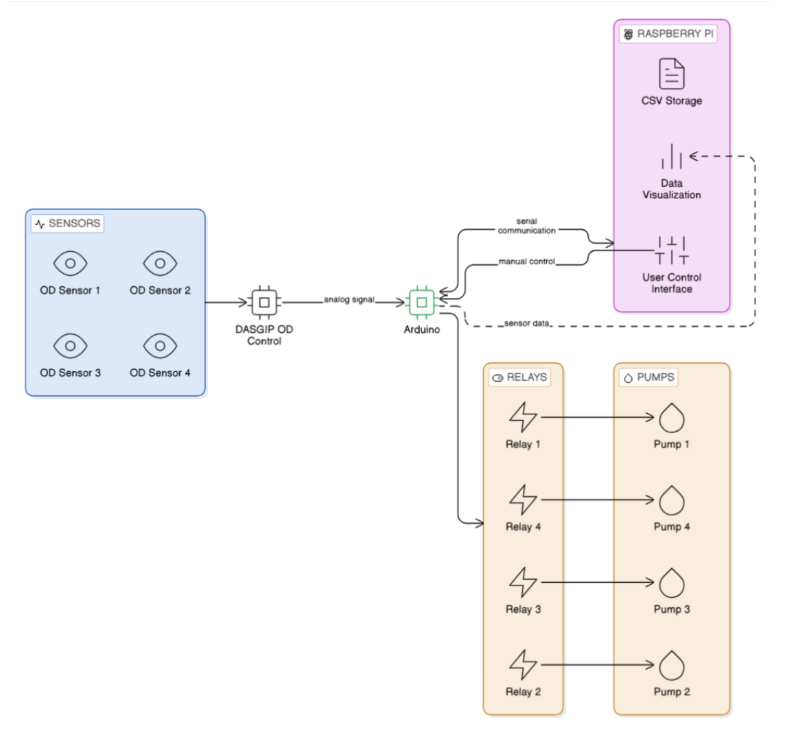
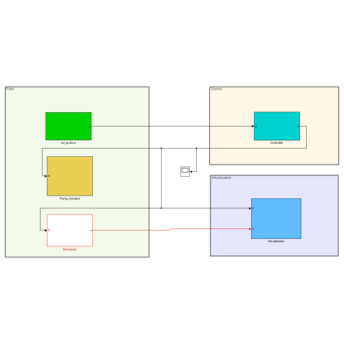
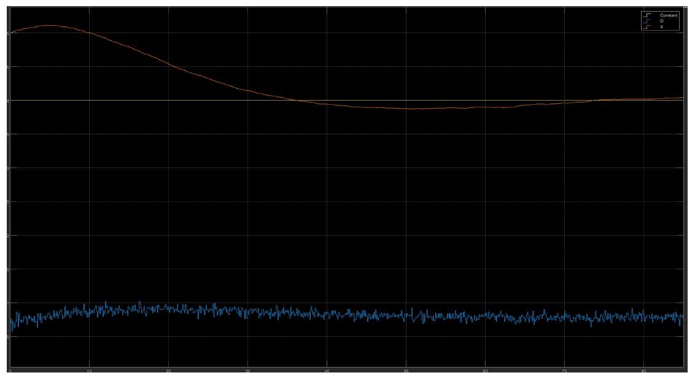
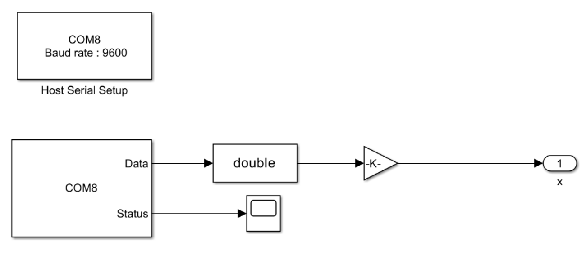

# TuRAC: Turbidostat Retrofit for Algae Cultures

Closed-loop optical-density (OD) control for a microalgae turbidostat. This repository holds the **simulation and hardware-in-the-loop (HIL)** part of the TuRAC retrofit project, built for the biotechnology lab at Hochschule Bremerhaven as part of the *Embedded Systems Design* course (report dated March 2026).

A turbidostat keeps a culture at a constant biomass concentration. It measures OD and adjusts the dilution rate with pumps. The legacy TuRAC setup had outdated software and no automatic feedback, so dilution was manual or fixed. The retrofit adds automatic OD-based control.



## System overview

| Layer | Component | Role |
|-------|-----------|------|
| Sensing | DASGIP OD4 module (4 channels) | Outputs 0–10 V proportional to OD |
| Signal conditioning | Voltage divider | Scales 0–10 V to the Arduino's 0–5 V ADC range |
| Control | Arduino Mega 2560 | Multi-channel PID with time-proportional relay switching |
| Actuation | Panasonic relays + peristaltic pumps | Dilute the culture |
| Supervision | Raspberry Pi 4 + Python GUI | Live plots, setpoints, PID tuning, CSV logging |

Before touching the real culture, the control logic was designed and tuned in a MATLAB/Simulink digital twin (this repo), then validated with an Arduino in the loop.

## Repository contents

```
simulink_matlab/
  Demo_newformula.slx      Simulink model (digital twin)
  ODSensorModel.m          OD sensor: OD = k·X + Gaussian noise (2 %)
  Controller.m             PI turbidostat controller, OD setpoint 0.4
  BioprocessModel.m        Biomass growth: dX/dt = (µ − D)·X, Euler step
  Pump_Actuator.m          Pump lag: D_out = 0.9 · D_in
arduino_hil/
  hil_stepped_response.ino Arduino sketch that streams a stepped OD signal to Simulink
docs/images/               Figures used in this README (from the project report)
```

Each `.m` file is the body of a MATLAB Function block in the Simulink model.

### Simulink model

The model is split into three areas: **Plant** (sensor, pump, bioreactor), **Control** (controller) and **Visualization**.



### Model parameters

| Parameter | Value |
|-----------|-------|
| OD setpoint | 0.4 |
| Kp / Ki | 0.25 / 0.02 |
| Controller sample time | 0.1 |
| Dilution rate limits | 0.01 – 0.6 h⁻¹ |
| Sensor noise | ±2 % Gaussian |
| Pump gain | 0.9 |

## Simulation result

Starting above the setpoint, the controller raises the dilution rate (blue) and the biomass concentration X (orange) settles at the OD setpoint (yellow line), with small fluctuations from sensor noise.



## Hardware-in-the-loop

To test the controller against real signals, the synthetic sensor block is replaced by a serial input from an Arduino. The sketch sends 8-bit values at 9600 baud every 100 ms. Simulink reads them through a Host Serial Receive block, converts them to `double` and scales them by 1/255.



The sketch in `arduino_hil/hil_stepped_response.ino` sends 179 (≈ 0.70) until 12 s, 145 (≈ 0.57) until 25 s, then 102 (= 0.40).

### Running it

1. Flash `arduino_hil/hil_stepped_response.ino` to an Arduino.
2. Open `simulink_matlab/Demo_newformula.slx` in MATLAB/Simulink.
3. Set the serial port (the report used `COM8`) and the baud rate (9600) in the Host Serial Setup block.
4. Run the simulation.

## Full project

The report covers the rest of the system: the embedded multi-channel PID firmware, the Raspberry Pi dashboard, the DASGIP OD4 integration (including why Modbus was abandoned in favour of an analog interface), and validation. The firmware and dashboard live in separate repositories.

## Authors

Embedded Systems Design project team, Hochschule Bremerhaven.
